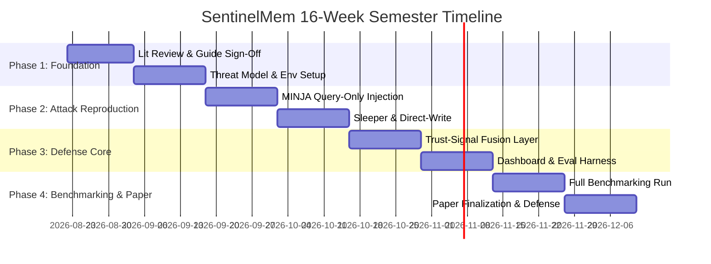

# SentinelMem: Cross-Backend Defense Against Memory Poisoning in LLM Agents

**SentinelMem** is a research and engineering project focused on developing a robust, cross-backend retrieval-time defense framework to protect Large Language Model (LLM) agents against memory poisoning attacks (such as MINJA query-only injections, sleeper/delayed triggers, and direct writes).

> Current implementation status: the repository now contains a deliberately
> small, deterministic FAISS plumbing baseline. It is not yet a reproduction of
> any published attack and does not make cross-backend security claims.

---

## 🧭 Project Management Framework & Interactive Dashboard

This repository contains the complete 14–16 week semester project management framework and an interactive dashboard to monitor sprint execution, code deliverables, research benchmarks, and paper milestones.

### Quick Start: Launch the Dashboard
Simply open [`index.html`](file:///f:/Projects/SentinelMem/index.html) in your browser:
```bash
# On Windows PowerShell:
Start-Process .\index.html
```

---

## 📑 Framework Overview (5 Interactive Tabs)

| Tab | Purpose | Key Tools & Views |
|---|---|---|
| **1. Overview** | High-level project snapshot | 4-Phase roadmap, active sprint indicators, critical path health, KPI progress meters |
| **2. Sprint Plan** | Sprints 1 to 8 execution | Granular task checklists, dates, objectives, and guide sign-off completion criteria |
| **3. Checklists** | Three-tier task management | Retrospective layer, Phase 2–3 Implementation (112 hrs), Weeks 1–15 Research & Writing (107 hrs) |
| **4. Weekly Tracking** | Friday EOD tracking cadence | Status update generator, automated $\pm 15\%$ variance engine, escalation alerts |
| **5. Dependencies & Risks** | Risk & contingency management | Critical path graph, built-in buffers (W11 & W14), 9-risk mitigation matrix, scope reduction triggers |

---

## 🗓️ 16-Week Semester Roadmap Snapshot



---

## 📚 Project Documentation Suite

- 📖 **[Master Project Framework](file:///f:/Projects/SentinelMem/docs/PROJECT_FRAMEWORK.md)**: Full 16-week execution guide, monthly review cadence, and governance rules.
- 🏃 **[Sprint Plan](file:///f:/Projects/SentinelMem/docs/SPRINT_PLAN.md)**: Sprints 1 to 8 with comprehensive task breakdowns and completion criteria.
- ✅ **[Checklists](file:///f:/Projects/SentinelMem/docs/CHECKLISTS.md)**: Retrospective, implementation, and research task budgets with effort estimates.
- 📅 **[Weekly Tracking Protocol](file:///f:/Projects/SentinelMem/docs/WEEKLY_TRACKING_TEMPLATE.md)**: Friday EOD reporting workflow and variance analysis rules.
- ⚡ **[Dependencies & Risks](file:///f:/Projects/SentinelMem/docs/RISKS_AND_DEPENDENCIES.md)**: Critical path analysis, 9-risk mitigation matrix, and contingency playbook.

---

## 🛠️ Technology Stack & Environment

- **Backends Supported:** Mem0, LangMem, FAISS
- **Trust Fusion Signals:** Semantic Drift, Temporal Anomaly, Provenance Tracking, Source Credibility
- **Defense Mechanisms:** Retrieval-time Filtering, Quarantine Policy, Adaptive Scoring
- **Dashboard Interface:** HTML5, Tailwind CSS, JavaScript (Vanilla with LocalStorage Persistence)

---

## Reproducible Baseline (v0.1)

The first executable milestone is a safe synthetic retrieval benchmark. Its
scope, assumptions, and limitations are defined in [the threat model](docs/threat-model.md)
and [experiment contract](docs/experiment-contract.md).

```powershell
py -m venv .venv
.\.venv\Scripts\Activate.ps1
python -m pip install --upgrade pip
python -m pip install -e ".[dev]"
python -m sentinelmem.baseline --config configs/faiss_baseline.json --output results/faiss_baseline.json
pytest
```

The dashboard remains a project-management tool. The executable benchmark is
the source of truth for research results; generated result JSON is intentionally
not committed.
